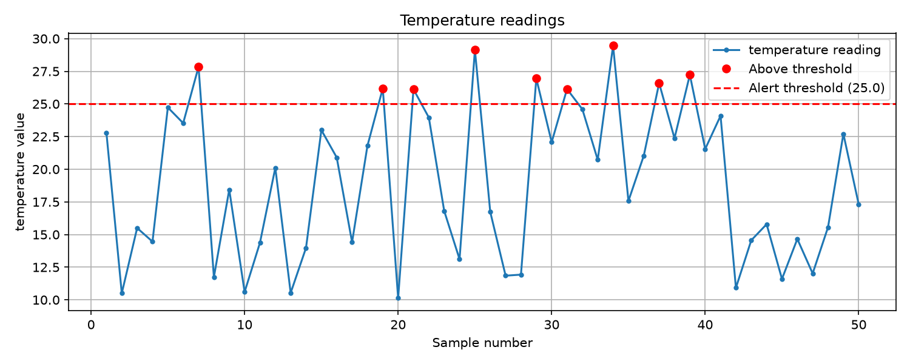
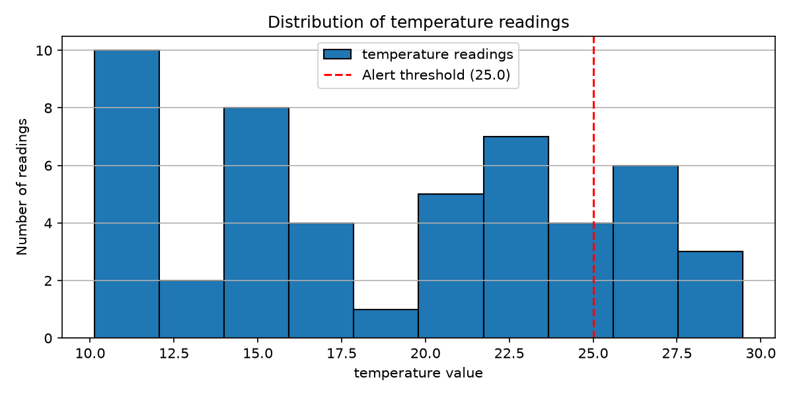

# Sensor Data Analysis Tool

A Python program that simulates sensor readings (or loads them from a CSV file),
analyzes them with NumPy and visualizes them with Matplotlib.

## Features
- Generate simulated readings for any sensor type (e.g. temperature, light), or load readings from a CSV file
- Statistics: number of readings, mean, minimum, maximum, standard deviation
- Detects and lists the readings above an alert threshold
- Line plot with the threshold line, and a histogram of the distribution (also saved as PNG)
- Saves the readings to `readings.csv`
- Handles invalid input with helpful messages (text instead of numbers, zero/negative counts,
  minimum ≥ maximum, file errors)
- Reproducible results thanks to `random.seed()`

## Requirements
- Python 3
- NumPy and Matplotlib (listed in `requirements.txt`)

## Installation
```bash
python -m pip install -r requirements.txt
```

## How to run
```bash
python sensor_monitor.py
```
Choose `1` to generate new readings or `2` to load an existing CSV file, then answer the questions.
Close the graph windows to end the program.

## Example
```
Choose 1 or 2: 1
Sensor type (e.g. temperature, light): temperature
Number of readings: 50
Minimum value: 10
Maximum value: 30
Alert threshold: 25
Saved 50 readings to readings.csv

--- temperature readings ---
Number of readings: 50
Mean:               19.01
Minimum:            10.13
Maximum:            29.46
Standard deviation: 5.81
Readings above 25.0: 9
```




## Files
| File | Contents |
|---|---|
| `sensor_monitor.py` | the program |
| `requirements.txt` | the packages the program needs |
| `readings.csv` | generated readings: sample number, sensor type, reading |
| `line_plot.png`, `histogram.png` | the saved graphs |